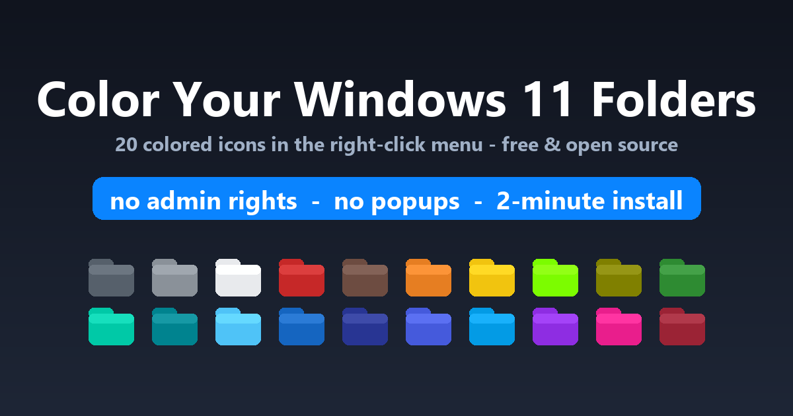
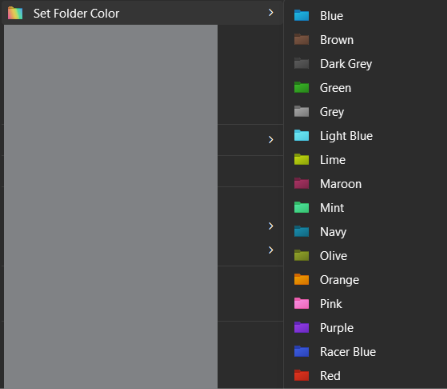

# Windows 11 Folder Colors

Adds a **`Set Folder Color`** submenu to the right-click menu of any folder in Windows Explorer, with **20 colored folder icons** and a **`Reset to Default`** action.

Works fully in the background — no console flashes, no GUI popups, no installer windows. Menu-only by design.



**Note: The `.icl` file used in this Project is Not Made by me, i only made the codes.**
([.icl Source](https://www.deviantart.com/abs96/art/Windows-11-coloured-folder-icons-896431403))

---

## 1. What it looks like

Right-click any folder:



*The real flyout — one entry, and the list continues past Red to White, Yellow, Teal and Space Blue, plus **Reset to Default**.*

- **20 colors + Reset**, each color child carries the real colored icon in the menu itself.
- `Reset to Default` lives **inside** the submenu and deletes the folder's `desktop.ini`, restoring the standard yellow folder icon.
- There is **no** separate one-click picker entry and **no** GUI dialog — the old `FolderColorPicker` entry was deliberately removed.

## 2. How it works (architecture)

The whole tool is four layers, each doing one job:

```
Explorer right-click
  → registry keys (HKCU\Software\Classes\Directory\shell\FolderColorMenu)
      → FolderColors.exe  --run color <folder> <index>   (hidden native runner, NO console)
          → app\Run-MenuAction.ps1                        (hidden PowerShell worker)
              → writes <folder>\desktop.ini with IconResource=<library>,<colorIndex>
                  → SHChangeNotify() P/Invoke → Explorer notices → icon refreshes
```

1. **Registry** — static shell verbs. The parent key `FolderColorMenu` has `MUIVerb = "Set Folder Color"` and `SubCommands` **empty on purpose** (a non-empty value makes Explorer resolve verbs from Explorer's CommandStore and renders an empty flyout). Each of the 21 children (`shell\<ColorId>\command` — 20 colors + Reset) contains the runner command with the color index.
2. **`FolderColors.exe`** — a small native C# runner (compiled from [launcher/AppLauncher.cs](launcher/AppLauncher.cs), no SDK needed). It is registered as the command for every menu item. It spawns PowerShell **with `CreateNoWindow = true`** — this is why nothing ever flashes. Double-clicking it deliberately does nothing (it has no GUI and refuses to act as an installer).
3. **`app\Run-MenuAction.ps1`** — the hidden worker. Applies (`--run color`) or resets (`--run reset`), writes `desktop.ini` as Unicode, sets folder attributes (`+s +r` on the folder, `+h` on the ini), then notifies the shell.
4. **Icon library** — `Windows_11_coloured_icons.icl` (6 MB, 20 colored folder icon resources indexed 0–19; the menu exposes all 20). Lives in the installed `icons\` folder; `desktop.ini` files point **absolute paths** at it.

### How each colored folder is stored

Every colored folder gets its own hidden `desktop.ini`:

```ini
[.ShellClassInfo]
IconResource=C:\Users\<you>\AppData\Local\Programs\FolderColors\icons\Windows_11_coloured_icons.icl,<index>
IconFile=C:\Users\<you>\AppData\Local\Programs\FolderColors\icons\Windows_11_coloured_icons.icl
IconIndex=<index>
```

### The classic-menu toggle (important on Windows 11)

Windows 11's default compact right-click menu **cannot host static registry verbs at all**. The tool sets a per-user toggle that re-enables the classic full menu as default:

```
HKCU\Software\Classes\CLSID\{86ca1aa0-34aa-4e8b-a509-50c905bae2a2}\InprocServer32   (empty default value)
```

- With it: the submenu appears on the **first** right-click (this is how the owner runs it now).
- Without it: entries only appear under **Show more options** (Shift+F10).
- Without a signed/packaged MSIX shell extension there is no way into the compact menu itself — documented limitation, not a bug.

## 3. Verified working state (audit of the owner's current setup)

| Component | State on this device |
|---|---|
| OS / PowerShell | Windows 11 26300 (25H2), PowerShell 5.1 — supported and tested |
| Menu entry | `FolderColorMenu` - MUIVerb `Set Folder Color`, **21 children** (20 colors + Reset) |
| GUI picker entry | **absent** (removed everywhere: registry, installer, worker, legacy .reg) |
| Installer exes | **none** (Setup/Uninstall/Install deleted from source, build and app dir; runner-only exe) |
| Classic menu | **enabled** (entries on first right-click) |
| Installed runner | `%LOCALAPPDATA%\Programs\FolderColors\FolderColors.exe` (51,200 bytes, Oct 2026 build) |
| rundll32 remnants | **zero invocations anywhere** — `SHChangeNotify_RunDLL` was removed from newer shell32.dll builds (caused the old "Error in shell32.dll / Missing entry" popup). All notify paths use the P/Invoke now. |
| Apply / Reset flow | round-trip tested: exit 0, `desktop.ini` written with stable `%LOCALAPPDATA%` path, reset removes it |
| Evidence it's working | `app\Logs\menu-action-YYYY-MM-DD.log` — every action is logged there |

## 4. File-by-file guide (which file is which)

| File | Role |
|---|---|
| `FoldersColors/Install-FolderColors.ps1` | **The installer.** Deploys the app to `%LOCALAPPDATA%\Programs\FolderColors`, registers the menu, deletes legacy leftovers (GUI-picker key, FolderColor1/2, stub exes), re-points broken desktop.ini files, sets the classic-menu toggle with `-ClassicMenu`. |
| `FoldersColors/Uninstall-FolderColors.ps1` | **The uninstaller.** Removes all menu keys (incl. every legacy layout), deletes the app dir, restarts Explorer. |
| `FoldersColors/FolderColors.exe` | The hidden runner (the only exe). Compiled output; never call it by hand — the menu does. |
| `FoldersColors/Windows_11_coloured_icons.icl` | The icon library — 20 color resources indexed 0–19, **all 20 now in the menu** — **third-party**, see the credit up top. |
| `FoldersColors/MenuIcon.ico` | Icon shown on the menu entry itself. |
| `FoldersColors/Repair-FolderColors.ps1` | Re-points broken `desktop.ini` files at the live library. Dry-run by default; pass `-Apply`. |
| `FoldersColors/Set-FolderIcon.ps1` | Apply a color from a script: `-Folder <path> -IconIndex 3 -Apply`. |
| `FoldersColors/Reset-FolderIcon.ps1` | Reset one folder from a script: `-Folder <path>`. |
| `FoldersColors/Install-FolderColors.reg`, `Uninstall-FolderColors.reg` | Legacy manual registry route (kept for reference; the PS installer is the real installer). |
| `FoldersColors/desktop.ini`, `FoldersColors/New folder/` | Marks the repo folder itself as colored — **not part of the tool**, ignore them. |
| `launcher/AppLauncher.cs` + `launcher/versioninfo.cs` | Runner source (C#, compiled with the in-box .NET 4 compiler). |
| `launcher/Run-MenuAction.ps1` | Worker source (copied to the app dir on install). |
| `launcher/build.cmd` | Rebuilds `FolderColors.exe` → `launcher/out/`. |
| `docs/og-image.png`, `docs/favicon.ico`, `README.md` | Docs and the release banner/favicon. The banner shows all 20 real library icons. |
| `%LOCALAPPDATA%\Programs\FolderColors\` | The **installed** copy (this is what actually runs; registry points here). |

## 5. Install on a NEW device

### Route A — release zip (recommended)

1. **Download** `FolderColors.zip` from the project's GitHub Releases page (the download page mirrors this guide). Extract it anywhere you like — e.g. `C:\Tools\FolderColors\`. Any folder works on disk; see § 7 before moving synced/cloud paths around later.
2. **Double-click `install.cmd`** inside the extracted folder. That's it — the console window shows progress and pauses at the end so you can read it. No admin rights, no execution-policy change (per-user HKCU only).
3. Right-click a folder: `Set Folder Color` is already there with all 20 colors and `Reset to Default`.

What `install.cmd` does: runs `Install-FolderColors.ps1 -ClassicMenu` (full right-click menu as default, same as this machine's setup). To install while keeping Windows 11's compact default menu, run the installer without `-ClassicMenu` from PowerShell instead.

### Route B — from a copy of this project (PowerShell)

```powershell
& "<path>\Windows11 Folder Colors\FoldersColors\Install-FolderColors.ps1" -ClassicMenu
```

### Install happens in 3 layers (all reversible)

| Layer | Location | Removed by |
|---|---|---|
| Program files | `%LOCALAPPDATA%\Programs\FolderColors` (runner, worker, icons, ps1 toolkit) | Uninstall-FolderColors.ps1 |
| Menu registry | `HKCU\Software\Classes\Directory\shell\FolderColorMenu` | Uninstall-FolderColors.ps1 |
| Classic menu toggle | `HKCU\...\CLSID\{86ca1a…34aa…}\InprocServer32` | kept by uninstaller on purpose; remove by hand: `reg delete "HKCU\Software\Classes\CLSID\{86ca1aa0-34aa-4e8b-a509-50c905bae2a2}" /f` |

### Uninstall

```powershell
& "%LOCALAPPDATA%\Programs\FolderColors\ps1\Uninstall-FolderColors.ps1"
```

Already-colored folders keep their `desktop.ini` (icons fall back to default since the library is gone). Run `Reset to Default` on them first if you want a clean restore.

## 6. Is it actually working? (how to tell)

The runner is silent by design, so verify like this:

1. **Logs are the smoke test** — after using any menu action, open `%LOCALAPPDATA%\Programs\FolderColors\app\Logs\menu-action-<today>.log`. A successful apply looks like:
   `[20:56:22] applied index 3 to C:\Users\you\Somewhere\MyFolder`
2. **desktop.ini exists** — show hidden system files (`Get-Item "<colored folder>\desktop.ini" -Force`) and you should see `IconResource=…` pointing at the installed `icons\` folder.
3. The menu entry itself — right-click a plain folder you never colored. The submenu is there whether or not the folder has a color yet.

## 7. Moving the tool afterwards = re-setup

`desktop.ini` files store **absolute paths** to the icon library. Therefore:

- **Do NOT move, rename, or OneDrive-sync `%LOCALAPPDATA%\Programs\FolderColors`** — that's the location everything points at, and it never moves.
- Moving/renaming the **extracted download folder** (the one with `install.cmd`) after installing is harmless — that copy was just the staging area; the live install lives in `%LOCALAPPDATA%` and the menu doesn't reference the staging copy at all. Still, keeping the extracted copy around is handy for uninstall/repair scripts; just don't rely on it after deleting it.
- If you ever break it anyway (renamed the library, moved the profile, etc.), run the repair script:
  ```powershell
  & "<staging folder>\Repair-FolderColors.ps1" -Apply -Roots @("C:\Users\you")
  ```
  or just reinstall — the installer auto-repairs broken `desktop.ini` files on every run.

## 8. Known behaviors and limitations

- **`desktop.ini` is applied instantly; Explorer is lazy.** Colors can take a few seconds (sometimes ~10) to *appear* — Explorer rebuilds its icon cache on its own schedule. The change itself already happened; clicking inside the folder, pressing F5, or restarting Explorer refreshes immediately. The owner has accepted this as-is (Windows behavior, tool already notifies the shell correctly).
- **One folder at a time** — the right-click verb hands the shortcut a single folder; multi-select is not supported by Explorer's verb mechanism.
- **Folders must be writable** (desktop.ini can be created/updated) — no effect on read-only system folders.
- **McAfee/AV false positives**: unsigned self-built exe → possibly quarantined. Add exclusions for `%LOCALAPPDATA%\Programs\FolderColors` and the staging folder; restore + rebuild once if it grabs the runner.

## 9. Building the runner from source

```cmd
launcher\build.cmd
```

Uses the in-box `C:\Windows\Microsoft.NET\Framework64\v4.0.30319\csc.exe` (C# 5). Output: `launcher\out\FolderColors.exe` + a payload copy. Rebuild only needed if you change the C# source or the worker script.

## 10. Troubleshooting

| Symptom | Cause / fix |
|---|---|
| Submenu missing entirely | Restart Explorer. Then re-run the installer; it logs exactly which keys it writes. |
| Entry only under "Show more options" | The classic-menu toggle isn't set (Windows 11). Re-install with `-ClassicMenu`. |
| Colors never appear at all, even after F5 | Check that `%LOCALAPPDATA%\Programs\FolderColors\icons\Windows_11_coloured_icons.icl` exists; if the folder was moved/rename = see § 7 repair. Check `app\Logs` for what actually ran. |
| "Error in shell32.dll / Missing entry" popup | This comes from running **old** copies that used the removed `SHChangeNotify_RunDLL` rundll32 export. Current installed scripts contain zero `rundll32` invocations (audited). Delete the stale copy and reinstall. |
| The old GUI picker opens | A legacy `FolderColorPicker` registry key survived somewhere. Uninstall, re-run the installer (it deletes that key), restart Explorer. |
| Console window flashes on every action | Registry points at `powershell.exe` fallback instead of the runner — that only happens when the runner exe was missing at install time. Reinstall so the runner gets deployed. |
